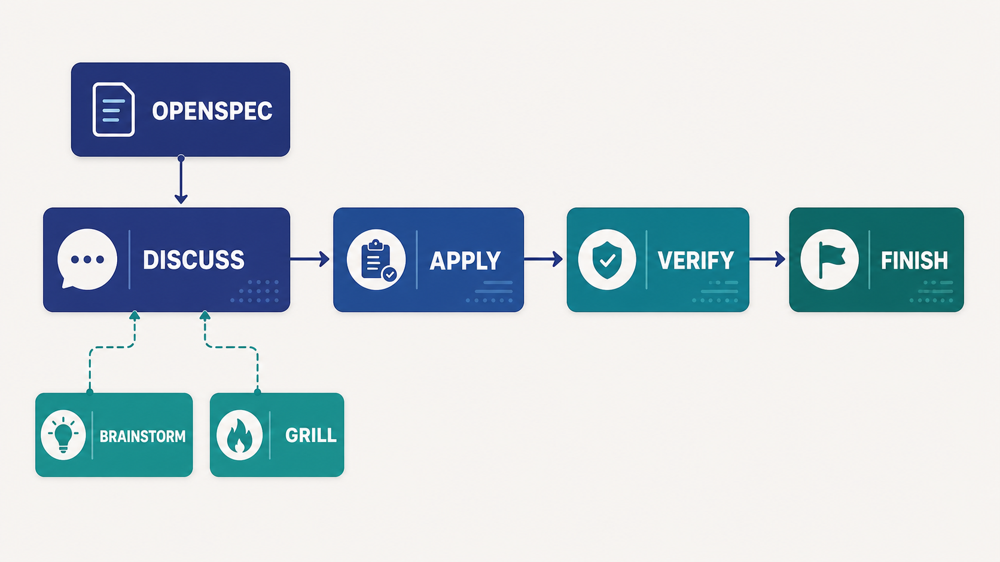
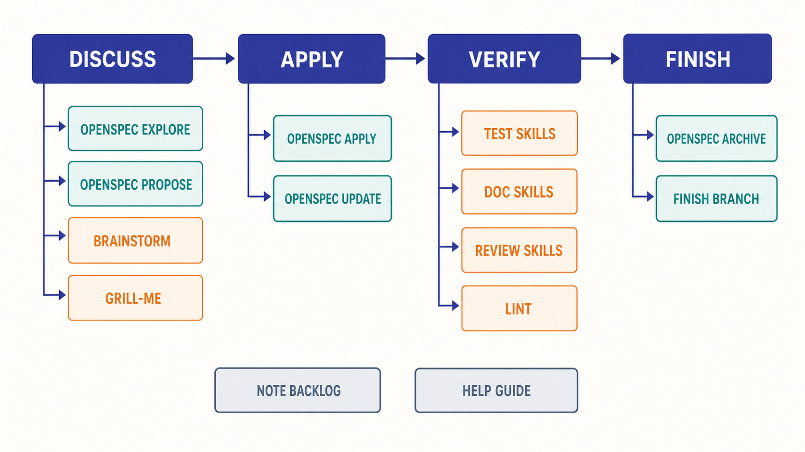
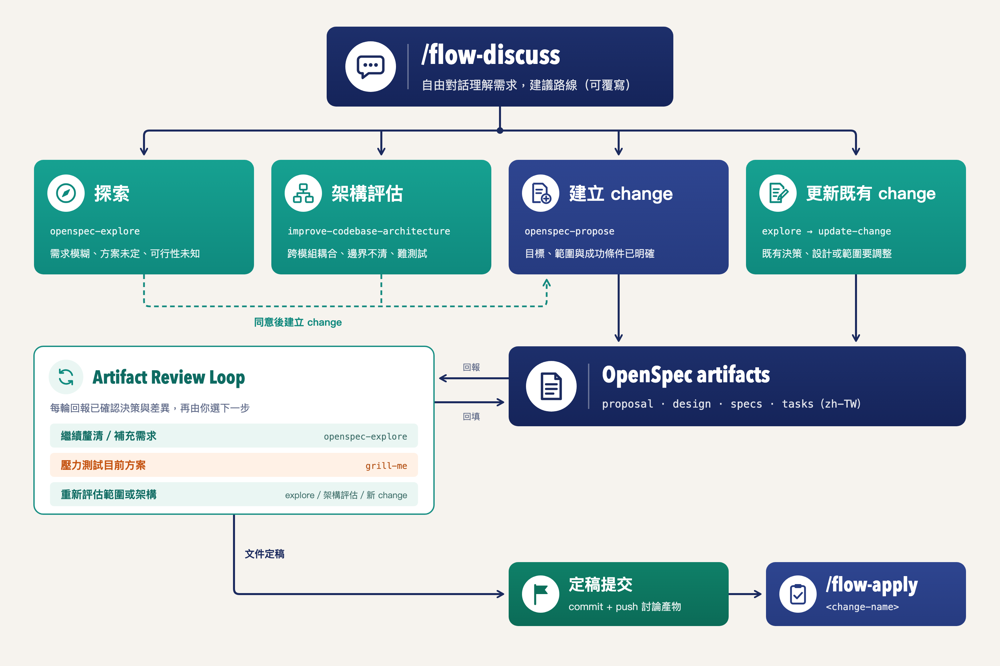

# OpenSpec Flow

以 [OpenSpec](https://github.com/Fission-AI/OpenSpec) 為文件與任務引擎的流程編排 skills。它將需求討論、實作、驗收與收尾串為一致的 change 生命週期，並補足分支、worktree、checkpoint、驗收紀錄及收尾整合等專案慣例。

```text
/flow-discuss → /flow-apply → /flow-verify → /flow-finish
   規劃與建檔      建工作區與實作    自動化驗收       歸檔與整合
```



這是個人 workflow 擴充，不是 OpenSpec 的官方建議流程。各 skills 會共用
[`flow-conventions/conventions.md`](flow-conventions/conventions.md) 的提問協定、
`.flow.yaml` 狀態格式、驗收工具設定與錯誤處理規則。

## 內容



| 目錄 | 用途 |
| --- | --- |
| `flow-discuss/` | 以自由對話理解需求，建議 explore、架構評估、proposal 或既有 change 更新路線；確認後才建立或修改 OpenSpec artifacts。 |
| `flow-apply/` | 依 change 類型建立分支或 worktree，委派 `openspec-apply-change` 實作 tasks；遇到規格偏差或未知異常時先探索／診斷，完成後可建立語意化 checkpoint。 |
| `flow-verify/` | 依使用者選定項目執行單元測試、文件註解、code review、Mermaid 架構圖與 use case 文件，並記錄本輪驗收結果。 |
| `flow-finish/` | 檢查驗收與工作區、同步 delta specs、archive change、提交並推送收尾變更，最後決定本地合併、建立 PR 或保留分支；中斷後可續跑。 |
| `flow-note/` | 開發途中的備忘錄，記到 `openspec/backlog.md`，不自動整合進其他 skill。 |
| `flow-help/` | 導覽入口，說明各 skill 用途、觸發時機與驗收工具設定速查。 |
| `flow-conventions/` | 所有 flow skill 共用的規範來源：提問協定、分支命名、`.flow.yaml` 結構、`config.yaml` 的 `flow:` 區塊、平台偵測與工具委派、錯誤處理原則。 |
| `assets/` | 說明文件用的圖片素材。 |

## 使用方式

日常只需記住四個主要入口：

| 情境 | 指令 |
| --- | --- |
| 有想法、需求、bug 或重構要規劃 | `/flow-discuss` |
| 已有 change，要開始或繼續實作 | `/flow-apply <change-name>` |
| tasks 完成，要跑驗收 | `/flow-verify <change-name>` |
| 驗收後要 archive、合併或建立 PR | `/flow-finish <change-name>` |
| 想記下之後再處理的事項 | `/flow-note` |
| 不確定該走哪個流程 | `/flow-help` |

`flow-discuss` 中的需求釐清維持自由對話；建立 artifacts、切換路線、提交或推送等決策則會明確詢問。所有 OpenSpec artifacts 一律以繁體中文（zh-TW）撰寫。

## 安裝

把上述 `flow-*` 目錄整組複製進你環境對應的 skills 目錄（例如 Claude Code 的
`.claude/skills/`），並保持 `flow-conventions/` 與各 `flow-*` 目錄同一層級——
skill 內部以相對路徑 `../flow-conventions/conventions.md` 讀取共用規範。

底層仍需先安裝好 OpenSpec：

```bash
npm install -g @fission-ai/openspec@latest
cd your-project
openspec init
```

## 設計原則



- **使用者表達意圖，不必先選 skill。** Flow 依目前上下文提出建議路線與理由，使用者始終可以覆寫。
- **討論自由，交付物一致。** 探索、架構評估與壓力測試的結論，都在確認後回填 OpenSpec artifacts。
- **實作與規劃保持同步。** 發現規格偏差時先暫停、探索並更新規劃；未知或不穩定的失敗先建立可重現的診斷回路。
- **驗收與整合分離。** `flow-apply` 的 checkpoint 只保存實作；`flow-verify` 與 `flow-finish` 皆由使用者另行明確觸發。
